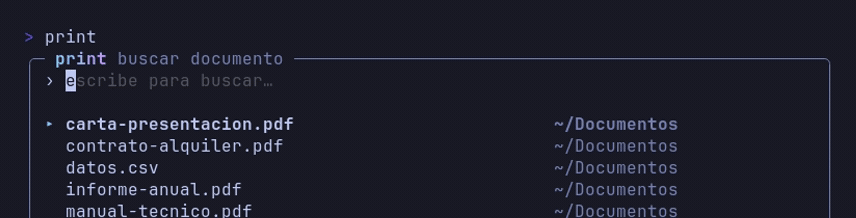
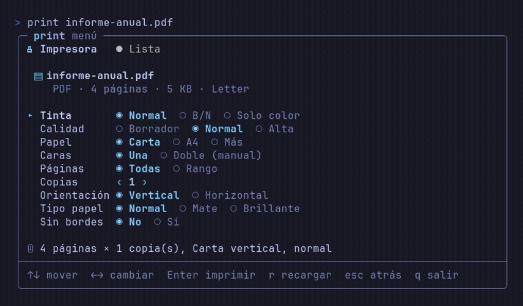

# CLI-Print

Menú de terminal para imprimir documentos en Linux sin recordar la sintaxis de
`lp`: eliges el archivo, ajustas cómo imprimirlo y confirmas. Funciona con
cualquier cola de CUPS.

> Documentación completa: [`docs/DOCUMENTACION.md`](docs/DOCUMENTACION.md)

## Vista rápida

Buscador difuso: escribe parte del nombre y la lista se filtra al instante.



Menú de impresión: copias, papel, tinta, doble cara y un resumen de lo que se va
a imprimir.



## Características

- Lista los documentos de **la carpeta actual** (PDF, Word, LibreOffice, texto,
  HTML, Markdown, CSV…) y los convierte a PDF con LibreOffice si hace falta.
- Búsqueda difusa al escribir: sin distinguir mayúsculas ni tildes. La lista
  muestra como mucho 10 documentos; con `↑↓` recorres el resto.
- **Doble cara manual**: imprime primero las caras de atrás y luego las de
  adelante para que, al girar el bloque por un borde largo, la página 1 quede
  arriba. Con un número impar de páginas añade sola una hoja en blanco.
- **Escala** cuando el PDF y el papel no coinciden: *Ajustar*, *Tamaño real*,
  *Estirar* y *Cubrir*. También gira los PDF apaisados.
- Tinta normal, blanco y negro o solo color; copias, rangos de páginas,
  orientación, tipo de papel y sin bordes.
- **Reanuda** un doble cara interrumpido entre las dos pasadas.
- Avisa de trabajos olvidados en la cola y permite cancelarlos o habilitarla.
- Subcomandos con salida JSON para integrarlo en scripts.

## Requisitos

- Linux con **CUPS** (`lpstat`, `lp`) y una cola configurada.
- **LibreOffice** (`soffice`) para convertir Office y texto a PDF.
- **Poppler** (`pdfinfo`, `pdftotext`, `pdftoppm`), **qpdf** y **Ghostscript**
  (`gs`).
- Fuentes de Office: `ttf-carlito` y `ttf-caladea` (Arch) o
  `fonts-crosextra-carlito` y `fonts-crosextra-caladea` (Debian/Ubuntu).

Arch Linux:

```bash
sudo pacman -S cups ghostscript poppler qpdf libreoffice-fresh \
  ttf-carlito ttf-caladea
sudo systemctl enable --now cups
```

Opcional: `cups-pdf` si quieres una impresora virtual que guarde los trabajos en PDF.

Para impresoras Canon antiguas (G1000/G2000, PIXMA…) hace falta Gutenprint:

```bash
sudo pacman -S gutenprint foomatic-db-gutenprint-ppds
```

## Instalación

Con `make`:

```bash
git clone https://github.com/Zobercito/cli-print.git
cd cli-print
make build
make install        # copia el binario a ~/.local/bin/print
```

O directamente con Go:

```bash
CGO_ENABLED=0 go build -trimpath -ldflags="-s -w" -o ~/.local/bin/print .
```

El binario se llama siempre **`print`**. Con `go install`, Go toma el último
elemento del módulo como nombre del ejecutable (`cli-print`), así que renómbralo
si quieres el nombre corto:

```bash
go install github.com/Zobercito/cli-print@latest
mv "$(go env GOPATH)/bin/cli-print" ~/.local/bin/print
```

Desinstalar: `make uninstall` y, si quieres borrar caché, estado y
configuración, `print --limpiar`.

## Uso

```bash
print                          # documentos de la carpeta actual
print docu                     # filtra por nombre en la carpeta actual
print informe.pdf              # va directo al menú de ese archivo
print "mi informe (v2).docx"   # nombres con espacios, tildes o comillas
print ~/Descargas/             # documentos de esa carpeta (sin subcarpetas)
print informe.pdf --dry-run    # muestra la orden lp y no imprime
```

Si el argumento no es un archivo ni una carpeta existente, se usa como texto de
búsqueda. Para imprimir algo de otra carpeta, `cd` allí y ejecuta `print`.

Teclas del menú: `↑↓` mover · `←→` cambiar · `Enter` imprimir · `r` recargar ·
`e` habilitar la cola · `x` cancelar trabajos · `esc` atrás · `q` salir.

### Sin terminal (scripts)

```bash
print --copias 2 --paginas 1-3 --papel A4 --tinta normal archivo.pdf
```

### Subcomandos

```bash
print estado [--json]
print trabajos [--json]
print detalles --cola <nombre> [--json]
print prueba --cola <nombre>
print cancelar <id> | --todos
print retener <id>
print liberar <id>
print habilitar
print imprimir <id> | --todos
print nombres '<json>'      # alias locales para las colas
```

Todos admiten `--json` y los que hablan con una cola admiten `--cola`.

## Escala

La fila **Escala** aparece cuando el PDF y el papel no coinciden, o cuando el
PDF es apaisado y la hoja va vertical.

| Opción | Qué hace | Franjas | Corta | Deforma |
|---|---|---|---|---|
| **Ajustar** (por defecto) | Cabe entero sin deformar | Sí, a los lados | No | No |
| **Tamaño real** | 1:1, alineado arriba y centrado | No | Sí, por abajo | No |
| **Estirar** | Llena la hoja escalando ancho y alto por separado | No | No | Sí, un poco |
| **Cubrir** | Llena la hoja sin deformar y recorta lo que sobra | No | Sí, arriba y abajo | No |

*Ajustar* y *Tamaño real* están a la vista; *Estirar* y *Cubrir* en **Más**.
Con A4 en papel Carta, *Ajustar* deja franjas a los lados, *Tamaño real* corta
~1,8 cm por abajo, *Estirar* deforma ~3 % de ancho y ~6 % de alto, y *Cubrir*
recorta ~1,3 cm arriba y abajo.

## Configuración

Opcional, en `~/.config/print/config.toml`. Hay un ejemplo en
[`docs/config.toml.ejemplo`](docs/config.toml.ejemplo):

```toml
impresora       = ""        # vacío = cola predeterminada de CUPS
tinta           = "color"   # color | normal | gris
animacion       = true
ascii           = false
giro            = "libro"   # libro | tortita
timeout_soffice = 60
```

## Pruebas

```bash
make test
go test ./...
```

Los tests de CUPS usan binarios falsos en `testdata/bin/`; los que necesitan
Ghostscript, Poppler o qpdf se saltan si no están instalados. Los PDF de las
pruebas con papel real están en `pruebas-papel/`.

## Estructura

| Archivo | Para qué |
|---|---|
| `main.go`, `cli.go`, `doc.go` | argumentos, subcomandos y documentación del paquete |
| `ui.go`, `update.go`, `vistas.go`, `tema.go` | interfaz (Bubble Tea) |
| `cups.go`, `estado.go`, `acciones.go`, `preflight.go`, `detalles.go`, `nombres.go` | hablar con CUPS |
| `duplex.go`, `duplexpdf.go`, `escala.go`, `construir.go`, `rangos.go` | lógica de impresión |
| `convertir.go`, `analizar.go`, `descubrir.go` | convertir, leer y listar documentos |
| `sesion.go`, `registro.go`, `config.go` | estado en disco |
| `docs/` | documentación completa, especificación y notas de diseño |
| `pruebas-papel/` | PDF de las pruebas con papel real |

## Notas

- Si la impresora no informa de los niveles de tinta, no se muestran.
- Un PDF apaisado en papel vertical: CUPS lo gira y lo reduce siempre; por eso
  *Tamaño real* y *Estirar* los prepara `print` con Ghostscript.
- Si se manda un trabajo con la impresora apagada, CUPS detiene la cola;
  `print` lo avisa y `e` la habilita.
- `docs/spec.md` es la especificación original; las secciones marcadas como
  «Actualización» recogen lo que se decidió después de probar con papel.

## Licencia

MIT. Consulta [`LICENSE`](LICENSE).
